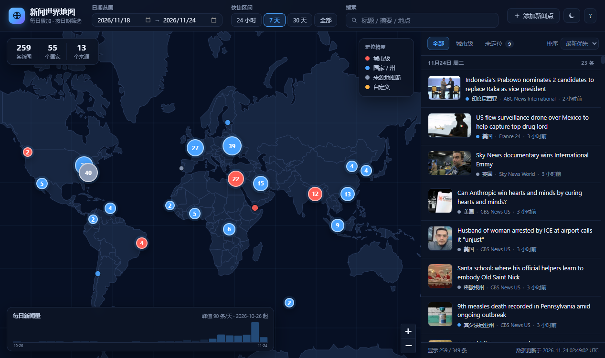
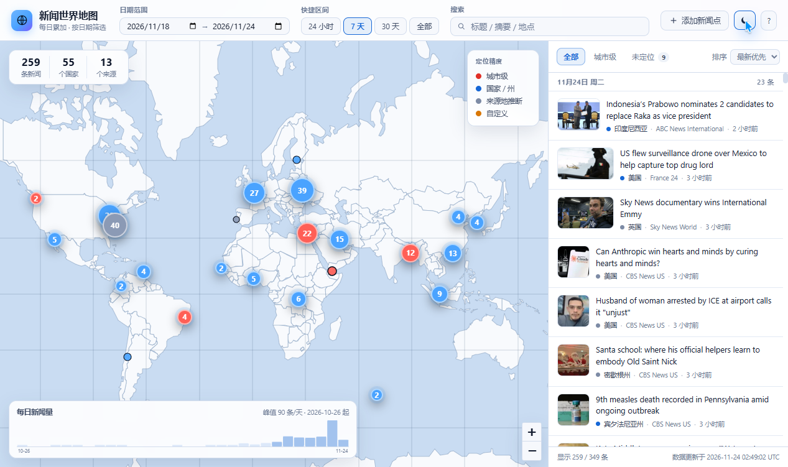
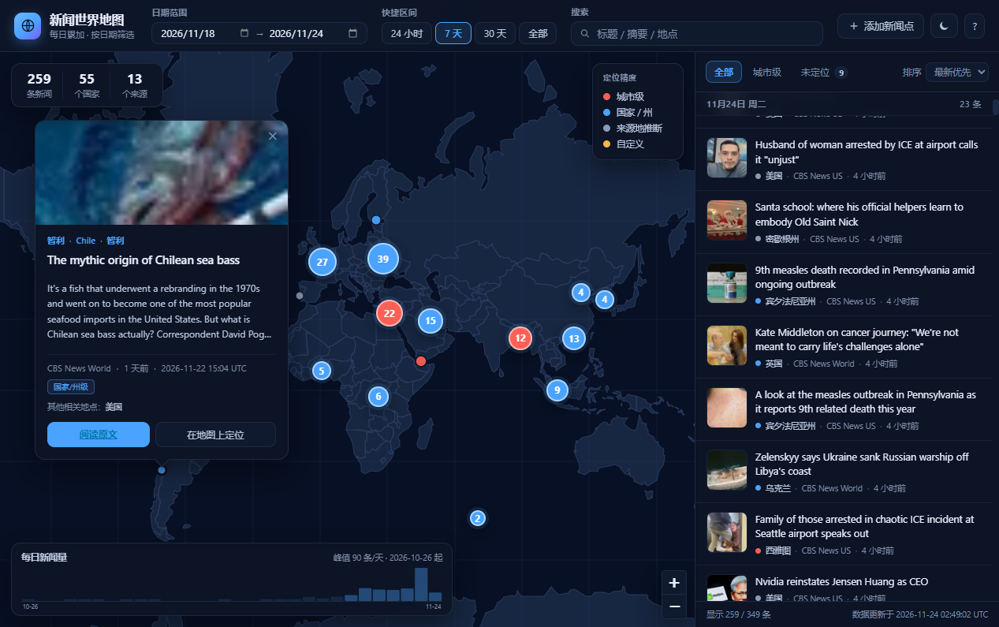
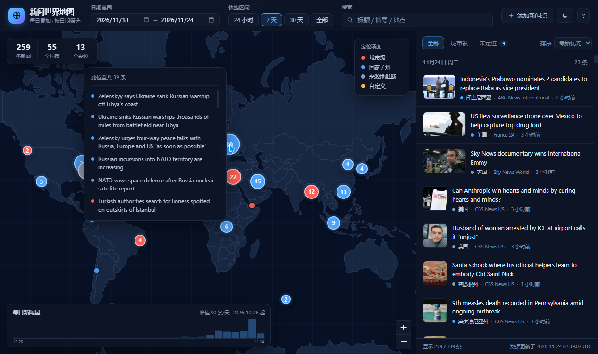

# News World Map

**Geolocate the world's news on a map — automatically, every day.**

[](LICENSE)
[](https://www.python.org/downloads/)
[](#quick-start)
[](LICENSE)

**Languages:** [English](README.md) · [简体中文](README_zh.md)



A static site plus a Python collector. It reads public RSS feeds, works out **where** each
story happened by analysing the headline and summary, and drops it on a world map.
Everything is local: **no `pip install`, no API key, no tile server, no CDN.**

---

## Features

- **Automatic accumulation.** Every run merges new stories into a rolling 90-day archive.
- **15 public RSS feeds** out of the box (NPR, CBS, Sky News, UN News, France 24, ABC News).
- **961-location gazetteer** with 2,251 aliases, covering countries, capitals, major cities,
  hot spots, US states and continents.
- **Honest precision colouring.** RSS carries no coordinates, so every pin states how it
  was located: city-level, country/state-level, or inferred-from-the-publisher.
- **Hover to read.** Point at any dot and its story card appears straight away — no clicking
  needed. Move the pointer into the card to keep it open, or click the dot to pin it.
- **Clustered map.** Hover a numbered bubble to list every story at that location; click a
  row to fly to it and open the detail card.
- **Date filtering.** Presets for 24 hours / 7 days / 30 days / all time, plus custom ranges.
- **Search** across headlines, summaries and place names.
- **Daily volume chart** in the corner — click a bar to jump to that day.
- **Add your own points** by clicking anywhere on the map (stored in your browser).
- **Light and dark themes.**
- **Runs offline.** Leaflet and the world borders are inlined, so once a snapshot has
  been published `web/index.html` opens straight from the filesystem.

---

## Quick Start

### Requirements

Python 3.8 or newer, and a modern browser. That's it — the collector uses **only the
Python standard library**, so there is nothing to `pip install`.

### Windows

1. Download or clone the repository and unzip it.
2. **Double-click `run.bat`.**
3. Open <http://127.0.0.1:8000/> in your browser.

Two windows appear: *"新闻世界地图 - 本地服务"* (keep it open — closing it stops the server)
and a second one showing collection progress. The page opens in about three seconds, empty —
**the repository deliberately ships no news data** — and fills in once the first collection
finishes (~10–40 s); it then picks up new stories on its own.

> Install Python from <https://www.python.org/downloads/> and **tick "Add python.exe to PATH"**.
> `run.bat` looks for `py -3` and then `python`, and tells you if it finds neither.
>
> If `run.bat` flashes and closes: Python is probably missing from `PATH`. Run `python --version`
> in a terminal; if it says *"not recognized"*, reinstall Python with the PATH option enabled.
> Extracting the project to a path **without spaces or non-ASCII characters**
> (e.g. `D:\newsmap`) avoids most batch-file path quirks.

### macOS / Linux

```bash
cd news-world-map
./run.sh
```

Then open <http://127.0.0.1:8000/>.

### What the scripts do

| Command | What it does |
|---|---|
| `run.bat` / `./run.sh` | Collect **and** serve — the everyday command |
| `serve.bat` / `./serve.sh` | Serve only — shows the last published snapshot (collect at least once first) |
| `daily.bat` / `./daily.sh` | Collect, then publish (good for a scheduled task) |
| `run.bat 9000` / `PORT=9000 ./run.sh` | Use a different port |
| `python3 -m collector.collect` | Collect only, from Python directly |
| `python3 scripts/publish.py` | Publish the snapshot into `web/data/` (validate first) |
| `python3 scripts/publish.py --window-days 60` | Publish a wider window (default: 30 days) |
| `python3 -m collector.build_gazetteer` | Rebuild the gazetteer from scratch |

Both `run.*` variants start the local server **immediately** and collect in the background,
writing progress to `collect.log`. Every collection is followed by a publish step that
validates the data against the contract and writes the snapshot into `web/data/`.

### Open it without a server

`web/` is a self-contained static site. Once a snapshot has been published, double-clicking
`web/index.html` works over `file://` — the map, the scripts and the data are all local.
Since the repository ships no news data, a fresh clone has to collect once first
(`daily.bat` / `./daily.sh`); after that the page needs no server at all.

### What you do *not* need

No server, no domain, no Docker, no database, no cloud account, no API key.

---

## Screenshots

### The map, in the light theme



### Hovering a dot shows its story card



Point at any dot and the card appears immediately — headline, summary, source and all.
Move the pointer away and it folds itself back up; click the dot to pin it open while you
follow the *"read the original"* link. Only one panel is ever on screen at a time.

### Hovering a cluster lists every story there



Hovering a numbered bubble opens a scrollable list of every story located at that point.
Move the pointer into the panel to keep it open; click a row to fly to the story.

### Clicking a story opens the detail card


The card shows the image, headline, summary, source, timestamp, the precision badge and any
other places the same story mentions.

---

## Using the interface

| Area | What it does |
|---|---|
| **Date range** (top left) | Start and end date, **default: the last 7 days** |
| **Presets** | 24 hours / 7 days / 30 days / all time |
| **Search** | Matches headline, summary and place name |
| **Add point** | Enter annotate mode, then click the map to add your own entry (kept in your browser) |
| **Stats** (top left of map) | Story count, country count and source count for the current filter |
| **Timeline** (bottom left) | Daily story volume — click a bar to jump to that day |
| **Story list** (right) | Grouped by day. Click an entry to fly to it and open the detail card. Filter with *All* / *City-level* / *Unlocated* |
| **Map markers** | Colour = how precisely the story was located, size = accuracy. Numbered bubbles are clusters. **Hover a dot for its story card; click to pin it open** |

### What the colours mean

Because RSS feeds contain no geographic metadata, every position is **inferred from text**,
and the map says so:

| Colour | Meaning | Example |
|---|---|---|
| 🔴 City-level | A specific city appears in the headline | "Istanbul" |
| 🔵 Country / state | A country or US state appears | "Ukraine" |
| ⚪ Inferred from source | No place name in the text, so it is placed at the publisher's home country — **the least certain** |
| 🟠 Custom | A point you added yourself | — |

Internally each match also carries a numeric confidence (`high ≥ 0.90`, `medium ≥ 0.55`,
`low < 0.55`), and a cluster takes the colour of its **majority** of stories, so a couple of
low-confidence fallbacks cannot repaint a city-level cluster.

---

## Where the data comes from

15 public RSS feeds, all free and keyless:

| Feed | Publisher |
|---|---|
| NPR World, NPR US | NPR |
| CBS News World, CBS News US | CBS |
| Sky News World | Sky News |
| UN News (general, Asia-Pacific, Europe) | United Nations |
| France 24 (main, Africa, Asia-Pacific, Americas, Middle East, Europe) | France 24 |
| ABC News International | ABC News |

The daily pipeline:

```
fetch RSS  →  parse headline / summary / time / image
           →  match place names (gazetteer + on-the-fly discovery)
           →  de-duplicate (hash of the headline + normalised URL)
           →  merge into the archive  →  write data/news.json
           →  validate against contract/news-v1.json
           →  strip the collector's internal fields, cut to the last 30 days
           →  publish the snapshot    →  web/data/
```

History is kept for **90 days**, capped at **4000 stories**.

### The published window

Your machine keeps the **full 90-day archive** in `data/news.json`. The page does not need
all of it, so the publisher trims the snapshot before writing it:

- it **strips the collector's internal fields** (`tkey`, `ukey`, `fallback`, `section`,
  `source_id`) — de-duplication keys and implementation details the map has no use for.
  The contract marks them *must not be depended on*; stripping them turns that from a
  convention into a hard boundary, so the published snapshot matches the contract field
  for field.
- it **cuts the snapshot to the last 30 days**, so a growing archive never turns into a
  growing download.

The published payload records the window in `window_days`, and the page says so in its
stats bar — *"published: last 30 days"* — so *"All"* is never mistaken for the whole
history. Widen it with `python3 scripts/publish.py --window-days 60`, or publish everything
with `--window-days 0`.

### How a location is inferred

1. **The gazetteer** — `data/gazetteer.json`
   - 250 countries (English, official and Chinese names, spelling variants, possessive forms, capital coordinates)
   - 239 capitals, 375 major cities, 31 hot spots (Gaza, Crimea, Kashmir…)
   - 51 US states, 8 continents / regions
   - All coordinates come from the free [Open-Meteo](https://open-meteo.com/) geocoding API
2. **Scoring** — a city beats a country, a country beats a state, a state beats a continent;
   a match in the headline beats a match in the summary.
3. **Guarding against false positives**
   - Latin-script place names must be capitalised, so *"nice day"* is never read as Nice.
   - Short aliases (`US`, `UK`, `UAE`…) must be written in full capitals.
   - Ambiguous country names (`Turkey`, `Jordan`, `Chad`, `Guinea`…) need a locative
     preposition (*in*, *at*, *from*) to confirm — but possessive forms (*Turkish*,
     *Jordanian*) are accepted as-is.
4. **Self-extension** — a capitalised proper noun that is not in the gazetteer (say
   `Pokrovsk`) is sent to Open-Meteo once. It is adopted only if it is a populated place of
   at least 100,000 people at first administrative level or above, and it is written back to
   the gazetteer — so the gazetteer grows as the archive does.

Rebuild the gazetteer from scratch with:

```bash
python3 -m collector.build_gazetteer
```

### Known limits

Positions are inferred from text, so they are only as good as the text. A story that never
names a place lands at the publisher's home country (the ⚪ grey markers) — treat those as
"filed from somewhere in this region", not as an exact location. The detail card lists the
other places a story mentions, which is the fastest way to sanity-check a pin.

---

## Keeping it up to date

News data is **not** stored in the repository. `data/news.json` and the published snapshot in
`web/data/` are runtime artefacts — excluded by `.gitignore` — so every clone starts empty and
builds its own archive on the first collection. To keep it fresh afterwards, run a collector on
a schedule.

### Windows — Task Scheduler

1. Press `Win + R`, type `taskschd.msc`, hit Enter.
2. *Create Basic Task* → trigger: Daily at 07:00.
3. Action: *Start a program*
   - Program: `C:\Windows\System32\cmd.exe`
   - Arguments: `/c "D:\path\to\news-world-map\daily.bat"`
   - *Start in*: `D:\path\to\news-world-map`
4. Afterwards, `collect.log` holds one entry per run.

### macOS / Linux — crontab

```bash
crontab -e
# collect once a day at 07:00
0 7 * * * /absolute/path/news-world-map/daily.sh >> /absolute/path/news-world-map/collect.log 2>&1
```

The page re-checks for new data every minute, so a refresh is enough to see the result.

---

## Two independent modules

The project is split into two modules that only ever talk to each other through an explicit
data contract:

| Module | Lives in | Owns | Knows about the other side |
|---|---|---|---|
| **Collector** (news acquisition) | `collector/` | `data/` | nothing |
| **Map** (presentation) | `web/` | the page | nothing |

The contract is `contract/news-v1.json` — one machine-readable file describing every field.
A small validator on each side reads it: `collector/contract.py` (Python) and
`web/contract.js` (browser).

```
collector.collect  →  data/news.json  →  scripts/publish.py  →  web/data/
                                                    ↓ validate against contract/news-v1.json
                                        web/data/news-data.js  +  contract.js
```

`scripts/publish.py` is the only file that knows both sides exist. It **refuses to publish
data that does not match the contract**: it prints the offending field paths and leaves the
previous snapshot untouched, so the page keeps showing the last good data instead of
something half-broken.

The collector writes **only** `data/news.json` — it has no idea a website exists. Publishing
is a separate, explicit step, so *"collected but never published"* can never be mistaken for
*"up to date"*.

Because the news is a runtime artefact rather than repository content, a clone carries the
code, the contract and the gazetteer — not the stories. `scripts/publish.py` rebuilds
`web/data/` from `data/news.json` on every run, trimming the snapshot on the way
(see [The published window](#the-published-window)).

---

## Project layout

```
news-world-map/
├── run.bat / serve.bat / daily.bat    # Windows one-click scripts
├── run.sh / serve.sh / daily.sh       # macOS / Linux one-click scripts
├── collector/                         # MODULE 1 — the collector (standard library only)
│   ├── config.py        # feeds and constants
│   ├── feeds.py         # RSS fetching and parsing
│   ├── gazetteer.py     # place-name matching engine
│   ├── geocode.py       # on-the-fly place discovery
│   ├── normalize.py     # text normalisation and de-duplication keys
│   ├── contract.py      # data-contract validator (Python side)
│   ├── build_gazetteer.py  # rebuild the gazetteer from scratch
│   └── collect.py       # main pipeline — writes data/news.json and nothing else
├── contract/
│   └── news-v1.json     # the data contract both modules agree on
├── scripts/
│   └── publish.py       # the bridge: validate data/news.json → publish to web/data/
├── data/                # MODULE 1's private data
│   ├── gazetteer.json   # the gazetteer (in the repo)
│   └── news.json        # the full 90-day archive — runtime artefact, not in the repo
├── web/                 # MODULE 2 — the static site (self-contained, opens over file://)
│   ├── index.html / app.js / style.css
│   ├── contract.js      # data-contract validator (browser side)
│   ├── data/            # contract.js is in the repo; the trimmed snapshot is not
│   └── vendor/          # Leaflet + world borders (inlined, works offline)
├── docs/
│   ├── screenshot-dark.png / screenshot-light.png
│   ├── screenshots/     # interaction screenshots
│   └── superpowers/specs/  # design notes
├── LICENSE              # MIT
└── README.md / README_zh.md
```

---

## FAQ

**The page is empty.**
The repository ships no news data, so this is the expected state of a fresh clone. Collect
first: `daily.bat` on Windows, `./daily.sh` on macOS/Linux — or `python3 -m collector.collect`
followed by `python3 scripts/publish.py`. Feeds that cannot be reached are skipped — the rest
still load.

**Why isn't the news data in the repository?**
News changes by the hour; committing it would bury the code in churn. The repository carries
the collector, the contract and the gazetteer, and each clone builds its own archive on the
first run.

**Why does the page only show the last 30 days?**
That is the published window — the archive on your machine keeps the full 90 days. Run
`python3 scripts/publish.py --window-days 90` to publish the whole archive instead.

**Some stories appear to be in the wrong country.**
That is the ⚪ *inferred from source* marker: the headline and summary really did contain no
place name, so the story was placed at the publisher's home country. The badge in the detail
card tells you which tier a story belongs to.

**Can I add more feeds?**
Yes — edit the `FEEDS` list in `collector/config.py`. Each entry needs
`id / name / region / country / url`, then collect again.

**Can I change the default window to 14 days?**
Change the `7` in `setPreset(7)` in `web/app.js`, or just use the date fields.

**Does it work on a Raspberry Pi or in a container?**
Yes — it is plain Python and a static site. Run the collector on a schedule and serve `web/`
with any web server.

---

## Contributing

Pull requests are welcome. A few notes:

- **Keep it dependency-free.** The collector must stay on the Python standard library, and
  the site must keep working over `file://` with no CDN.
- **Add a feed** by editing `collector/config.py`; include the publisher's name and their
  country so stories with no place name can still be placed sensibly.
- **Improve the gazetteer** through `collector/build_gazetteer.py` rather than by hand-editing
  `data/gazetteer.json`, so it stays reproducible.
- **Match the surrounding style.** Code comments and UI strings are in Chinese; the
  documentation lives in `README.md` (English) and `README_zh.md` (Chinese), and the two
  should stay in sync.
- The design notes in `docs/superpowers/specs/` explain why the collector is shaped the way
  it is — worth reading before changing the matching rules.

---

## Data licensing and credits

News **content** remains the property of the original publishers. This project only fetches
headlines, summaries, timestamps and image links, and always links back to the original
article. The gazetteer is built from [Natural Earth](https://www.naturalearthdata.com/)
(public domain) and [Open-Meteo](https://open-meteo.com/) GeoNames data (CC BY 4.0). World
borders are [Natural Earth](https://www.naturalearthdata.com/) 110m via
[world-atlas](https://github.com/topojson/world-atlas). The map is drawn with
[Leaflet](https://leafletjs.com/).

## License

[MIT](LICENSE) © 2026 Xster
