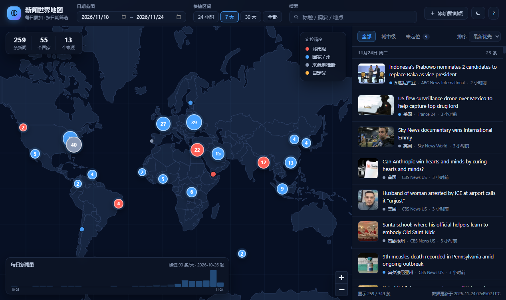
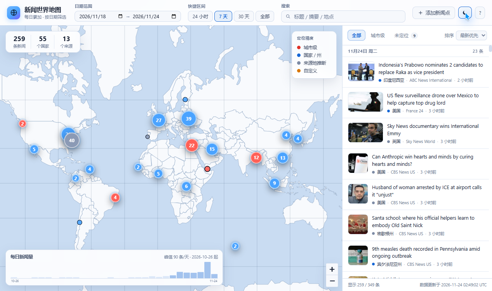
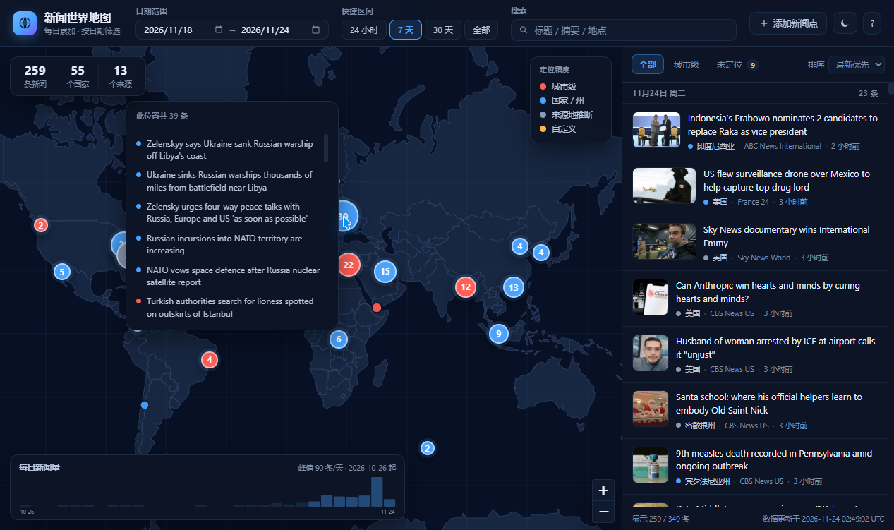

# 新闻世界地图 · News World Map

**把世界新闻自动定位到地图上，每天自动累加。**

[](LICENSE)
[](https://www.python.org/downloads/)
[](#快速开始)
[](LICENSE)

**语言：** [English](README.md) · [简体中文](README_zh.md)



一个静态站点 + 一个 Python 采集器。读取公开 RSS 源，通过分析标题与摘要来判断**每条新闻发生在哪里**，然后标注到世界地图上。
全程本地：**不需要 `pip install`、不需要 API key、不需要瓦片服务、没有 CDN 外链。**

---

## 功能

- **自动累加。** 每次运行都会把新新闻并入滚动 90 天的历史档案。
- **内置 15 个公开 RSS 源**（NPR、CBS、Sky News、联合国新闻、France 24、ABC News）。
- **961 条地点的地点库**，带 2,251 个别名，覆盖国家、首都、主要城市、热点地区、美国州与大区。
- **诚实的精度标注。** RSS 本身不含坐标，所以每个点都标明它是**怎么**定位出来的：城市级、国家/州级，还是按媒体总部推断。
- **悬停即看。** 鼠标移到任意圆点上，新闻卡片立刻展开，不用点击；移开自动收起，点一下则固定住。
- **聚合点。** 鼠标悬停带数字的气泡，即可列出该位置的全部新闻；点其中一条直接飞过去看详情。
- **日期筛选。** 24 小时 / 7 天 / 30 天 / 全部，外加自定义起止日期。
- **搜索**标题、摘要与地点名。
- **每日新闻量柱状图**，点某一天即可跳过去。
- **自定义新闻点**：进入标注模式后在地图上任意位置点击添加（存在浏览器本地）。
- **明暗双主题。**
- **离线可用。** Leaflet 与世界国界全部内联，发布出快照后 `web/index.html` 直接双击就能打开。

---

## 快速开始

### 前置条件

Python 3.8+，外加一个现代浏览器。采集器**只用 Python 标准库**，没有任何东西需要 `pip install`。

### Windows

1. 下载或克隆本仓库并解压。
2. **双击 `run.bat`。**
3. 浏览器打开 <http://127.0.0.1:8000/>。

会弹出两个窗口：一个是「新闻世界地图 - 本地服务」（保持打开，关掉即停止服务），另一个显示采集进度。
页面约 3 秒就能打开，此时是空的——**仓库刻意不附带新闻数据**——第一次采集完成后（约 10～40 秒）内容会自动填上，之后每次更新页面都会自己检测。

> 安装 Python：<https://www.python.org/downloads/>，安装时**务必勾选 `Add python.exe to PATH`**。
> `run.bat` 会依次检测 `py -3` 和 `python`，都找不到会给出提示。
>
> **双击 `run.bat` 一闪而过？** 多半是 Python 没装或没进 PATH。在 cmd 里敲 `python --version` 试试；
> 如果提示不是内部或外部命令，重装 Python 并勾上那个选项。
> 另外把项目解压到**不含空格和中文**的目录（比如 `D:\newsmap`）再试，能避开绝大多数批处理路径问题。

### macOS / Linux

```bash
cd news-world-map
./run.sh
```

浏览器打开 <http://127.0.0.1:8000/> 即可。

### 脚本能做什么

| 命令 | 作用 |
|---|---|
| `run.bat` / `./run.sh` | 采集 + 启动服务（日常用这个） |
| `serve.bat` / `./serve.sh` | 只启动服务，显示已发布的快照（需先采集过一次） |
| `daily.bat` / `./daily.sh` | 采集并发布（适合挂定时任务） |
| `run.bat 9000` / `PORT=9000 ./run.sh` | 换端口 |
| `python3 -m collector.collect` | 直接用 Python 采集 |
| `python3 scripts/publish.py` | 把快照发布到 `web/data/`（先校验再发布） |
| `python3 scripts/publish.py --window-days 60` | 发布更宽的窗口（默认 30 天） |
| `python3 -m collector.build_gazetteer` | 重建地点库 |

`run.*` 系列会**立刻**启动本地服务，同时在后台采集，日志写到 `collect.log`。
每次采集之后都会紧跟一步发布：按契约校验数据，再把快照写进 `web/data/`。

### 不用服务也能看

`web/` 是一个自包含的静态站点。发布出快照之后，直接双击 `web/index.html` 用 `file://` 打开同样正常——
地图、脚本和数据全在本地。仓库不附带新闻数据，所以刚克隆下来要先跑一次采集
（`daily.bat` / `./daily.sh`）；做完之后这个页面就完全不需要服务器了。

### 不需要的东西

没有服务器、没有域名、没有 Docker、没有数据库、没有云资源、没有 API key。

---

## 界面截图

### 浅色主题



### 悬停圆点即显示新闻卡片


鼠标移到任意圆点上，卡片立刻展开——标题、摘要、来源一应俱全。
移开鼠标它会自己收回去；点一下圆点则固定住，方便点「阅读原文」。
屏幕上同一时刻只会有一张卡片。

### 悬停聚合点，列出该处的全部新闻



鼠标悬停带数字的气泡，会弹出一个可滚动的清单，列出定位在这个位置上的所有新闻。
把指针移进面板可以保持打开；点其中一条，地图会飞过去并弹出详情卡。

### 点开一条新闻，看详情卡


详情卡里有图片、标题、摘要、来源、时间、精度徽章，以及同一条新闻提到的其他地点。

---

## 界面说明

| 区域 | 作用 |
|---|---|
| **日期范围**（左上） | 起止日期筛选，**默认最近 7 天** |
| **快捷区间** | 24 小时 / 7 天 / 30 天 / 全部 |
| **搜索** | 匹配标题、摘要与地点名 |
| **添加新闻点** | 进入标注模式后，在地图上任意位置点击即可添加自定义条目（存在浏览器本地） |
| **统计条**（地图左上） | 当前筛选范围内的条数、覆盖国家数、来源数 |
| **每日新闻量**（左下） | 每日新闻量柱状图；点击某一天即可跳到那一天 |
| **右侧列表** | 按天分组的新闻流；点列表项 → 地图自动飞过去并弹出详情；可切「全部 / 城市级 / 未定位」 |
| **地图圆点** | 颜色代表定位精度，大小代表精确度；带数字的是聚合点。**悬停圆点即显示新闻卡片，点一下则固定住** |

### 定位精度的含义

RSS 里没有任何地理字段，每一条新闻的位置都是**从文本推断出来的**，所以地图会把依据标出来：

| 颜色 | 含义 | 例子 |
|---|---|---|
| 🔴 城市级 | 标题里出现了具体城市 | "Istanbul"「伊斯坦布尔」 |
| 🔵 国家 / 州 | 出现了国家名或州名 | "Ukraine"「乌克兰」 |
| ⚪ 来源地推断 | 文中没有地名，按媒体总部所在国家放置 —— **最不确定的一档** |
| 🟠 自定义 | 你自己添加的 | — |

内部还会给每次匹配打一个数值置信度（`high ≥ 0.90`、`medium ≥ 0.55`、`low < 0.55`）；
聚合点的颜色取其中**多数派**的档位，所以几条兜底新闻不会把一个城市级聚合点染成红色。

---

## 数据从哪来

15 个公开 RSS 源，全部免费无需密钥：

| 源 | 媒体 |
|---|---|
| NPR World / NPR US | 美国之音 |
| CBS News World / CBS News US | CBS |
| Sky News World | 英国天空新闻 |
| UN News（综合、亚太、欧洲分区） | 联合国新闻 |
| France 24（综合、非洲、亚太、美洲、中东、欧洲分区） | 法国国际广播 |
| ABC News International | 美国 ABC |

**每天的更新流程**

```
抓 RSS → 解析标题/摘要/时间/图片
       → 地名匹配（地点库 + 未知地名自动扩展）
       → 去重（标题哈希 + 归一化 URL）
       → 与历史数据合并（累加）→ 写回 data/news.json
       → 按 contract/news-v1.json 校验
       → 裁掉采集器内部字段、截取最近 30 天
       → 发布快照 → web/data/
```

历史数据默认保留 **90 天**，上限 **4000 条**。

### 发布窗口

你本机的 `data/news.json` 保存着**完整的 90 天档案**。页面用不到全部，所以发布器在写出前
先把快照裁一刀：

- **裁掉采集器的内部字段**（`tkey`、`ukey`、`fallback`、`section`、`source_id`）——这些是去重键
  与实现细节，地图端根本用不到。契约里本就标了「前端不得依赖」，裁掉之后这就从一句约定
  变成了数据层面的硬边界，发布出去的快照与契约逐字一致。
- **把快照截成最近 30 天**——档案再涨，页面的下载量也不会跟着涨。

发布产物用 `window_days` 记录实际窗口，页面在统计条里如实写明「已发布最近 30 天」，
这样点「全部」的人不会误以为那就是完整历史。想放宽就
`python3 scripts/publish.py --window-days 60`，想全量就加 `--window-days 0`。

### 定位是怎么做的

1. **地点库** `data/gazetteer.json`
   - 250 个国家（英文名 / 官方名 / 中文名 / 异体拼写 / 属格形式 / 首都坐标）
   - 239 座首都、375 座主要城市、31 个热点地区（加沙、克里米亚、克什米尔…）
   - 51 个美国州、8 个洲 / 大区
   - 全部经纬度由 [Open-Meteo](https://open-meteo.com/) 免费地理编码 API 生成
2. **打分**：城市 > 国家 > 州 > 洲；出现在标题 > 出现在摘要
3. **防误判**
   - 拉丁文地名必须大写出现，`nice day` 不会被当成「尼斯」
   - 短别名（`US` / `UK` / `UAE`…）必须全大写，避免命中英文代词
   - `土耳其 / 约旦 / 乍得 / 几内亚` 这类本身是常用词的国家名，需要方位介词（in / at / from）佐证；
     但属格形式（Turkish、Jordanian）免检
4. **自扩展**：标题里的库外大写专名（如 `Pokrovsk`）会送一次 Open-Meteo 地理编码，
   人口 ≥ 10 万且属于一级行政区以上才采纳，并写回地点库 —— 地点库会随档案一起长大

想重建地点库：

```bash
python3 -m collector.build_gazetteer
```

### 已知的误差边界

位置是从文本推断的，所以上限就是文本本身。一条从头到尾没提到地名的新闻只能落在媒体总部所在国
（也就是那些 ⚪ 灰点）—— 应当理解成「来自这个区域」，而不是精确位置。
详情卡里列出了同一条新闻提到的其他地点，这是核对一个点是否合理最快的方式。

---

## 每日自动更新

新闻数据**不存放在仓库里**。`data/news.json` 与发布到 `web/data/` 的快照都是运行时产物，
已被 `.gitignore` 排除——所以每次克隆都是空的，第一次采集时自己建一份档案；之后要保持新鲜，
就得挂一个定时采集。

### Windows：用「任务计划程序」

1. Win + R 输入 `taskschd.msc` 打开任务计划程序
2. 「创建基本任务」→ 每天 → 07:00
3. 操作选「启动程序」，
   程序填 `C:\Windows\System32\cmd.exe`，
   参数填 `/c "D:\path\to\news-world-map\daily.bat"`（路径换成你的实际位置），
   「起始于」填 `D:\path\to\news-world-map`
4. 完成后打开 `collect.log` 能看到每天的采集记录

### macOS / Linux：系统 crontab

```bash
crontab -e
# 每天 07:00 采集一次
0 7 * * * /绝对路径/news-world-map/daily.sh >> /绝对路径/news-world-map/collect.log 2>&1
```

页面每分钟自动检查一次数据，采集完刷新一下即可看到。

---

## 两个独立模块

项目被拆成两个模块，双方只通过一份显式的数据契约通信：

| 模块 | 位置 | 拥有 | 是否知道对方的存在 |
|---|---|---|---|
| **采集器**（新闻获取） | `collector/` | `data/` | 不知道 |
| **地图**（展示） | `web/` | 页面 | 不知道 |

契约是 `contract/news-v1.json`——一份描述了所有字段的机器可读文件。
两侧各有一个小校验器读它：`collector/contract.py`（Python 侧）与
`web/contract.js`（浏览器侧）。

```
collector.collect  →  data/news.json  →  scripts/publish.py  →  web/data/
                                                   ↓ 按 contract/news-v1.json 校验
                                       web/data/news-data.js  +  contract.js
```

`scripts/publish.py` 是唯一知道双方都存在的文件。**数据不符合契约时它会拒绝发布**：
打印出问题的字段路径，原地保留上一份快照，页面继续显示上一次的好数据，
而不是半坏的状态。

采集器**只**写 `data/news.json`，它完全不知道有个网站存在。发布是独立的、显式的一步，
所以「采集了但没发布」不会再被误当成「已经是最新」。

因为新闻属于运行时产物而不是仓库内容，克隆下来拿到的是代码、契约与地点库——不是新闻本身。
`scripts/publish.py` 每次运行都会从 `data/news.json` 重建 `web/data/`，顺手把快照裁一刀
（见[发布窗口](#发布窗口)）。

---

## 目录结构

```
news-world-map/
├── run.bat / serve.bat / daily.bat    # Windows 一键脚本
├── run.sh / serve.sh / daily.sh       # macOS / Linux 一键脚本
├── collector/                         # 模块一：采集器（纯标准库）
│   ├── config.py       # 数据源与常量
│   ├── feeds.py        # RSS 抓取与解析
│   ├── gazetteer.py    # 地名匹配引擎
│   ├── geocode.py      # 未知地名自动扩展
│   ├── normalize.py    # 文本归一化与去重键
│   ├── contract.py     # 数据契约校验器（Python 侧）
│   ├── build_gazetteer.py  # 重建地点库
│   └── collect.py      # 主流程——只写 data/news.json，别的都不碰
├── contract/
│   └── news-v1.json    # 两个模块共同遵守的数据契约
├── scripts/
│   └── publish.py      # 桥：校验 data/news.json → 发布到 web/data/
├── data/               # 模块一的私有数据
│   ├── gazetteer.json  # 地点库（入库）
│   └── news.json       # 完整的 90 天新闻档案——运行时产物，不入库
├── web/                # 模块二：静态站点（自包含，可直接 file:// 打开）
│   ├── index.html / app.js / style.css
│   ├── contract.js     # 数据契约校验器（浏览器侧）
│   ├── data/           # contract.js 入库；裁剪后的快照不入库
│   └── vendor/         # Leaflet + 世界国界数据（已内联，离线可用）
├── docs/
│   ├── screenshot-dark.png / screenshot-light.png
│   ├── screenshots/    # 交互截图
│   └── superpowers/specs/  # 设计说明
├── LICENSE              # MIT
└── README.md / README_zh.md
```

---

## 常见问题

**页面是空的？**
仓库不附带新闻数据，所以刚克隆下来看到空页面是正常的。先跑一次采集：Windows 用 `daily.bat`，
macOS/Linux 用 `./daily.sh`；也可以 `python3 -m collector.collect` 之后
`python3 scripts/publish.py`。连不上的源会被跳过，不影响其他源。

**为什么仓库里没有新闻数据？**
新闻每时每刻都在变，进库只会把代码改动淹没在数据噪音里。仓库只保存采集器、数据契约与地点库，
新闻档案由每个克隆在首次运行时自己建立。

**页面为什么只有最近 30 天？**
那是发布窗口——你本机的档案保留完整 90 天。想全量发布就
`python3 scripts/publish.py --window-days 90`。

**有些新闻定位到了美国/法国，看着不对？**
那是 ⚪「来源地推断」—— 这条新闻的标题和摘要里确实没有提到任何地名，只能按媒体总部放置。
点开详情卡看置信度徽章就能区分。

**想加更多新闻源？**
编辑 `collector/config.py` 里的 `FEEDS` 列表，每项包含 `id / name / region / country / url`，
然后重新采集即可。

**想改成 14 天默认？**
改 `web/app.js` 里 `setPreset(7)` 的 `7`，或者直接用界面上的日期框。

**能在树莓派或容器里跑吗？**
可以 —— 就是普通 Python + 一个静态站点。定时跑采集器，再用任意 Web 服务器托管 `web/` 目录。

---

## 参与贡献

欢迎提 Pull Request。几点约定：

- **保持零依赖。** 采集器只能用 Python 标准库；站点必须继续能在 `file://` 下打开，不能引入 CDN 外链。
- **加新闻源**请改 `collector/config.py`，并写清媒体名称与所属国家，
  这样没有地名的新闻也能被放到合理的位置。
- **改地点库**请走 `python3 -m collector.build_gazetteer` 重新生成，而不是手改 `data/gazetteer.json`，以便复现。
- **跟随现有风格。** 代码注释与界面文案是中文；文档分 `README.md`（英文）与 `README_zh.md`（中文），
  两份需要同步更新。
- `docs/superpowers/specs/` 里的设计说明解释了采集器为什么是这个结构，改匹配规则前值得先读一遍。

---

## 数据许可与致谢

新闻**内容**版权归原媒体所有。本项目只抓取标题、摘要、时间与图片链接，并始终附上原文链接。
地点库基于 [Natural Earth](https://www.naturalearthdata.com/)（公有领域）与
[Open-Meteo](https://open-meteo.com/) GeoNames 数据（CC BY 4.0）；
世界国界为 [Natural Earth](https://www.naturalearthdata.com/) 110m，经
[world-atlas](https://github.com/topojson/world-atlas) 提供；地图由
[Leaflet](https://leafletjs.com/) 绘制。

## 许可证

[MIT](LICENSE) © 2026 Xster
